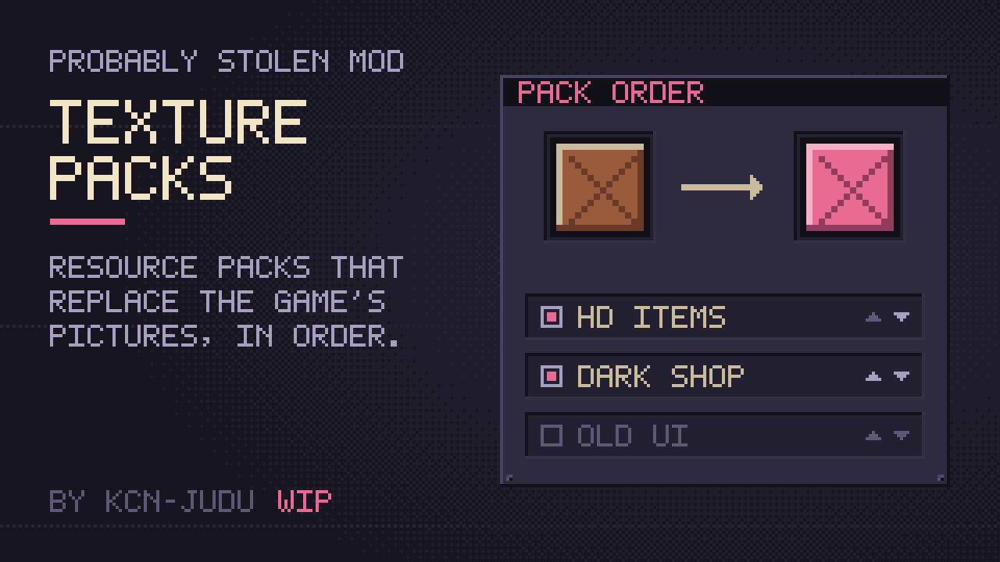

# Texture Packs (WIP)



A mod for *Probably Stolen*: a standard for resource packs, and the loader that applies them. A texture pack is a small mod that holds pictures; Texture Packs puts them in place of the game's own, from items and windows to the shop, its fixtures and the customers. A manager lists the installed packs in priority order: switch each one on or off, and the pack at the top wins where two replace the same picture.

**Work in progress.** Not released yet; things will change.

Part of the [Probably Stolen mods collection](https://github.com/KCN-judu/ProbablyStolen-Mods).

## Making a pack

See [Making a texture pack](doc/manual/making-a-pack.md). The creator kit (`tools/kit.sh`) holds the catalog of every picture a pack can replace, placeholders of the right sizes, a script that exports the game's pictures from your own copy of the game, and a tool that builds the pack. It holds no game art.

## Build

```bash
./build.sh            # out/texture_packs and out/texture_pack_template
./build.sh --install  # also copies the mod to the game's Mods folder
tests/run.sh          # the pure-logic tests and the game's own mod scanner
tools/kit.sh          # the creator kit, out/TexturePackKit.zip
```

`GAME` and `CSC` override the game folder and the C# compiler, as in the collection's other mods. After a game update, refresh the catalog first with `tools/export/inventory.py` (Python, see `tools/export/requirements.txt`), then run `tools/kit.sh`.

## Repository layout

| Path | Contents |
| --- | --- |
| `src/` | The mod's source |
| `Localization/` | In-game text, one file per game language |
| `template/` | The empty `TexturePack.dll` every pack carries, and a pack manifest |
| `catalog.tsv` | Every picture a pack can replace, with its file name, size and category |
| `tools/Catalog/` | Builds `catalog.tsv` and the placeholders from `inventory.json` |
| `tools/export/` | Reads the game's files: the inventory for the catalog, and the export for creators |
| `tools/PackBuilder/` | Turns a folder of pictures into a pack |
| `tools/SpriteProbe/` | Development mod that logs every sprite the game shows |
| `doc/manual/` | Documentation, in English |
| `manifest.xml`, `preview.png` | What the game reads, next to the DLL |
| `CHANGELOG.md` | Changes by version |

## License

[Apache License 2.0](LICENSE).
