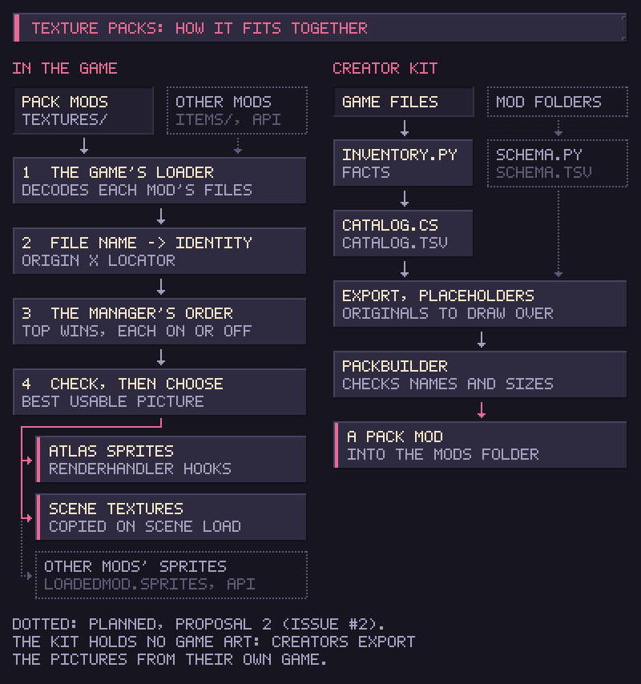

# How it works

The left side of the diagram is the mod in the game. The right side is the [creator kit](making-a-pack.md). Dotted boxes are not part of the mod yet.

## Finding the packs

A pack is an enabled mod that lists `texture_packs` among its prerequisites. The game's loader has already decoded every PNG in the pack's `Textures` folder, so Texture Packs reads nothing from disk. It reads the packs again each time a pack's assets finish loading, after Apply, and when you enable the mod from the Mods menu after start-up.

## What a file name means

The game reads only the top of the `Textures` folder, so the file name says what a picture replaces:

| Name | Replaces |
| --- | --- |
| `items~items_tool2@blender.png` | The sprite `blender` in the Resources atlas `items/items_tool2` (`~` stands for `/`) |
| `window~machinery~bevel_frame.png` | The single Resources sprite `window/machinery/bevel_frame` |
| `store_mid.960x540.png` | The whole scene texture `store_mid` of that size |

Scene textures carry their size in the name because several share a name. `wall`, for example, is 960x540 in the shop and 640x360 in the run summary. A PNG whose name is none of these is not a replacement, and the game keeps its own picture. A pack may hold such files.

## Which pack wins

For each picture, every switched-on pack that has a file for it is a candidate, the highest in the list first. A candidate the game cannot use is rejected before the order is considered: an unknown name or a wrong size. The first usable candidate wins. The usable ones below it count as covered.

## Sprites

Nearly every sprite reaches the game through `RenderHandler`. A postfix on `RenderHandler.LoadFromAtlasRaw` (which `LoadFromAtlas` and `TryLoadFromAtlas` call) and on `RenderHandler.LoadFromFile` swaps the game's sprite for the pack's. The new sprite has the original's size, pivot, pixels per unit and nine-slice border, so the game lays it out as before.

`RenderHandler` keeps the window frame and grid sprites in fields it fills once. Texture Packs sets those fields again after every apply and after `RenderHandler.Awake`.

Item shapes come from the transparency of the item's sprite. `GameItem.BuildShapeFromSprite` is patched to see the game's original, so a pack changes how an item looks and never which cells it takes.

## Scene textures

Backgrounds, fixtures, portraits and most of the interface are textures stored in the scene files. They do not pass through `RenderHandler`. After every scene load, Texture Packs copies the pack's pixels into the game's texture on the graphics card. Every sprite, animation frame and portrait cut from that texture changes at once. The original is kept aside and put back when the packs change or the mod is disabled.

The sizes must match exactly. A texture the game stores compressed as DXT1 or DXT5 is compressed again at run time to match. Other compressed formats cannot be replaced, and a graphics device that cannot copy textures keeps the game's pictures. Each case writes one warning to `Player.log`.

## The saved order

The order is one line in the config, top first, each pack marked `+` (on) or `-` (off), for example `+hd_items;-old_ui;+dark_shop`. A `%` or `;` inside a pack id is written as `%25` or `%3B`.
