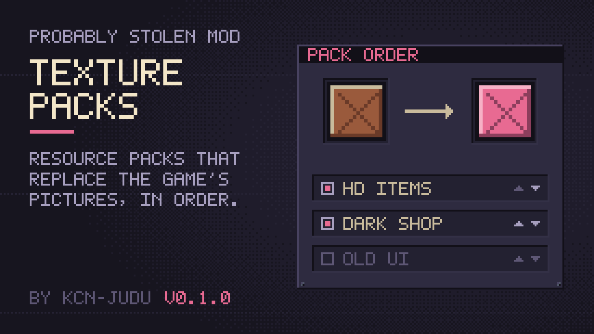

# Texture Packs

> [!NOTE]
> Texture Packs is in early access (0.1.0): it is still being tested and things will change. Discussion during development: [Discord thread](https://discord.com/channels/1315752321975845004/1567431485391372339).

Texture Packs lets mods replace the game's pictures. A texture pack is a small mod that holds pictures. Texture Packs puts them in place of the game's own: items, windows and buttons, the shop and its fixtures, the customers and the new-game screens.

A pack can also replace pictures that other mods add to the game, such as the items and papers of a gameplay mod. The mod's author does not have to change anything for that, and a mod that makes its sprites in code can offer them too. A pack names such a picture by the mod's id or UUID, and it only takes effect while that mod is enabled. See [For mod authors](for-mod-authors.md) and [Making a texture pack](making-a-pack.md#pictures-of-other-mods).

A pack replaces only the pictures it holds. The game's own pictures stay everywhere else. You can install several packs. Where two of them replace the same picture, the one higher in your list wins.

## Using packs

1. Put the pack's folder in the game's `Mods` folder.
2. Enable **Texture Packs** and the pack in the Mods menu, and restart the game.
3. Click the settings button of Texture Packs in the Mods menu. It opens the pack manager.

The pack manager lists the installed packs, the top one first. Each row has:

- a switch, to turn the pack off without uninstalling it;
- the pack's icon, if it has one, and a tooltip with its name, version, author, description and number of pictures;
- the number of its pictures in use, the number left out because a pack higher up replaces the same picture, and the number skipped;
- **Up** and **Down**, to move the pack one place.

Changes wait until you click **Apply**. Apply saves the order and puts the packs in place at once, without a restart. **Close** or Escape drops changes you did not apply.

A new pack starts on top and switched on. A pack that is no longer installed keeps its place in the saved order, so it returns to the same place when you install it again.

## Skipped pictures

A picture is skipped when the game has no picture of that name, when no enabled mod has the picture it names, or when its size differs from the original's. The pack manager counts them, and `Player.log` names each one and says why. A broken picture in a pack high in the list does not hide a good one in a pack below it.

## Settings

The pack manager is the only setting. The order and the switches are saved in the mod's config file as one entry, `packs`.

## Compatibility

Texture Packs needs no special permissions. It patches `RenderHandler.LoadFromAtlasRaw`, `RenderHandler.LoadFromFile`, `RenderHandler.Awake`, `GameItem.BuildShapeFromSprite`, `GameItem.SetSpriteAndShapeFromMod` and `ModConfigWindow.Open`. See [How it works](how-it-works.md).

To make a pack, see [Making a texture pack](making-a-pack.md).
